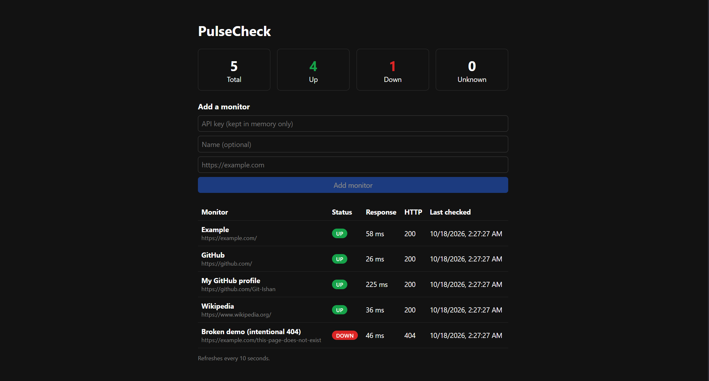
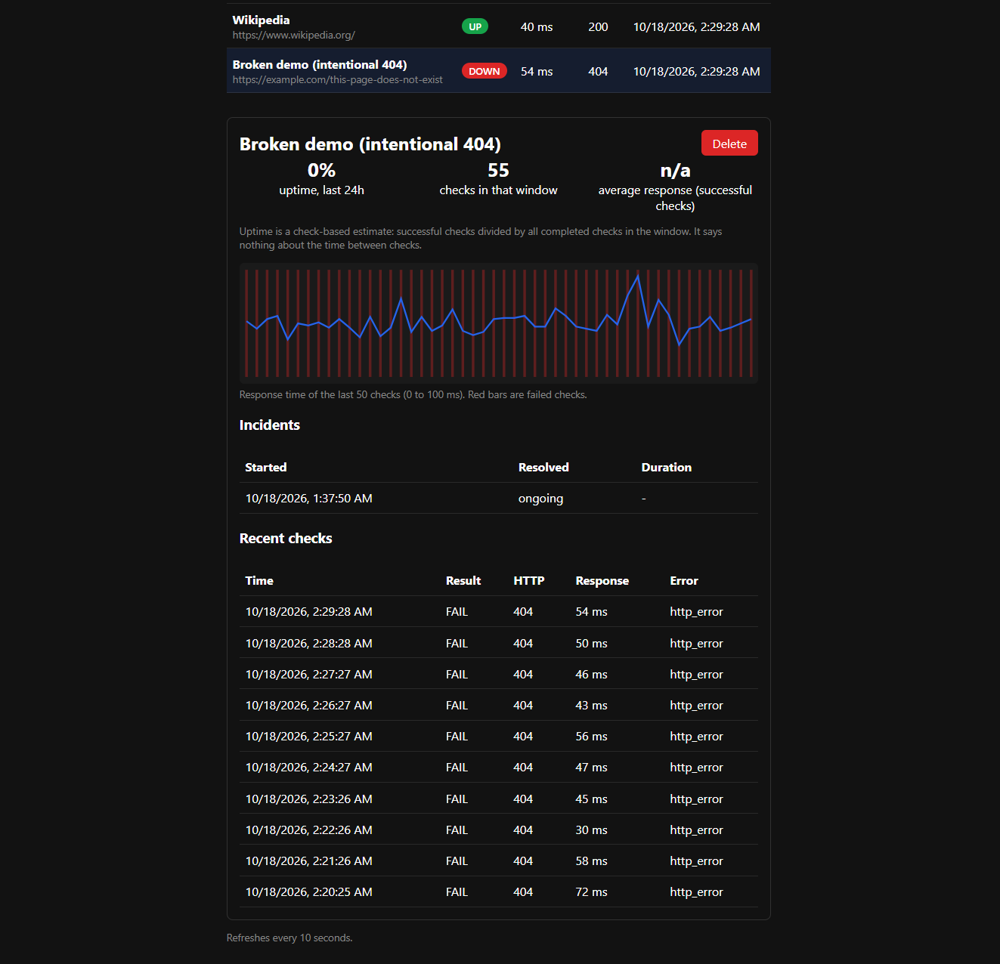
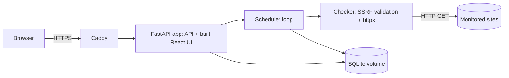

# PulseCheck

Uptime monitoring platform. Register a URL and PulseCheck checks it in the background, then shows UP/DOWN state, incidents, response times and uptime percentage.

**Live demo:** https://100-63-136-132.sslip.io (small AWS EC2 instance, may be offline)




## Features

- Monitor CRUD, asynchronous checks with bounded concurrency
- State machine: a monitor goes DOWN after 3 consecutive failures; a failure streak is discarded after a gap longer than 3x the check interval
- Incident history, response-time chart, check-based uptime shown with its sample size
- Health endpoints: `/health`, `/ready`, `/health/scheduler` (scheduler heartbeat)

## Architecture



One container serves both the API and the built UI, so there is no CORS in production. The scheduler runs inside the API process with a single uvicorn worker, because more workers would run duplicate schedulers.

## Security

- **SSRF protection** on creation and on every check, including every redirect hop (up to 5). Resolved addresses are validated, so hostnames that point to private or loopback IPs are rejected.
- Tested against the cloud metadata IP, localhost, private ranges, alternative IP encodings (decimal, hex, IPv6) and DNS names that resolve to loopback.
- Writes require an `X-API-Key` header; reads are public. With no key configured, writes return 503.
- The key lives only in React state in the browser, never in localStorage or build-time variables.
- Rate limiting and a cap on the number of monitors.
- Only response headers are read; bodies are never downloaded. The container runs as a non-root user.

## Tech stack

Python, FastAPI, SQLAlchemy, Pydantic, httpx, SQLite, pytest (113 tests) | React, TypeScript, Vite | Docker, Caddy (automatic HTTPS), GitHub Actions, GHCR, AWS EC2

## Run locally

```bash
docker build -t pulsecheck .
docker run -p 8000:8000 -e API_KEY=dev-key -v pulsecheck-data:/data pulsecheck
# open http://localhost:8000
```

Tests:

```bash
cd backend
pip install -r requirements.txt pytest
python -m pytest
```

## Deployment

GitHub Actions runs backend tests, frontend lint and build, and a Docker build, then publishes the image to GHCR. On the server, `deploy/docker-compose.yml` and `deploy/Caddyfile` run the app behind Caddy. Deploying is manual: `docker compose pull && docker compose up -d`.

The server needs a `.env` file with `DOMAIN` and `API_KEY` (see `deploy/.env.example`). `CHECK_INTERVAL_SECONDS` and `ALLOW_PRIVATE_TARGETS` are set in `deploy/docker-compose.yml`; `ALLOW_PRIVATE_TARGETS` must stay `false` outside local development.

## API

| Method | Path |
|---|---|
| POST, GET | `/monitors` |
| GET, DELETE | `/monitors/{id}` |
| POST | `/monitors/{id}/check` |
| GET | `/monitors/{id}/checks`, `/incidents`, `/uptime` |
| GET | `/stats`, `/health`, `/ready`, `/health/scheduler` |

Interactive API docs are served at `/docs`.

Interactive API docs are served at `/docs`.

## Limitations

- Single instance with SQLite; not built for horizontal scaling.
- No data retention yet: check history grows without pruning.
- Deploys are manual after CI publishes the image.
- No email alerts or user accounts (a single shared API key protects writes).
- Uptime is a check-based estimate, not time-based.
- Only HTTP(S) GET checks; a status below 400 counts as healthy.

## License

MIT